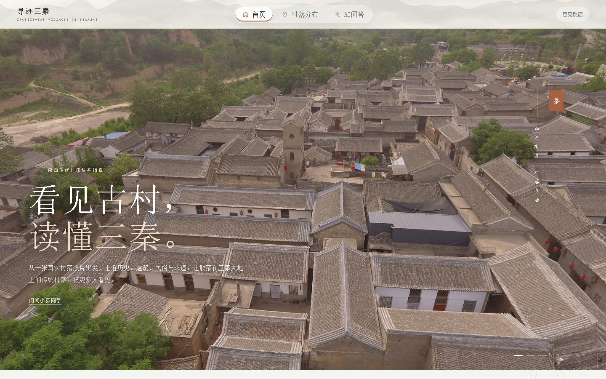
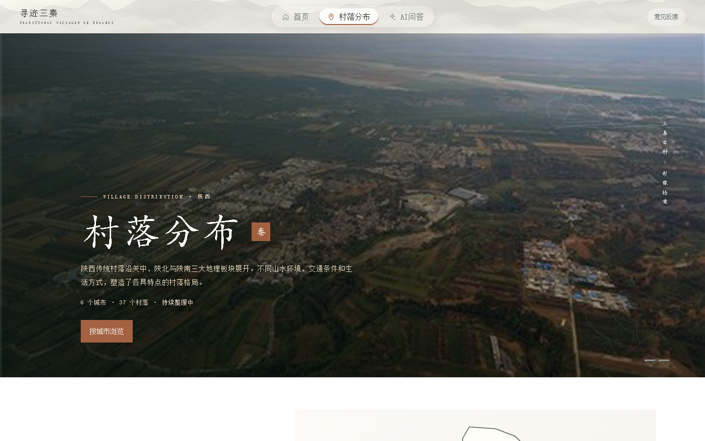
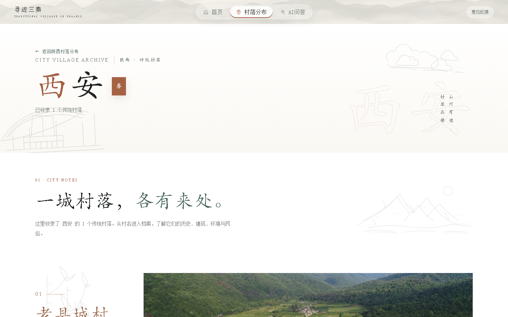
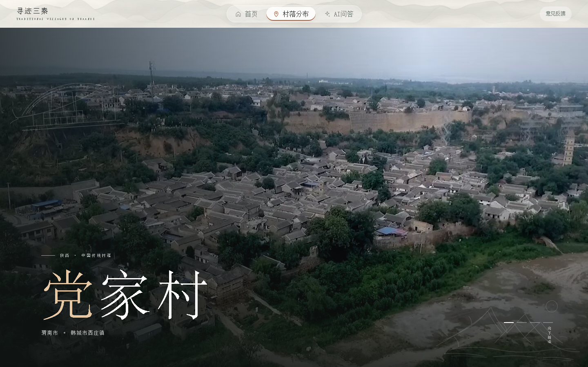
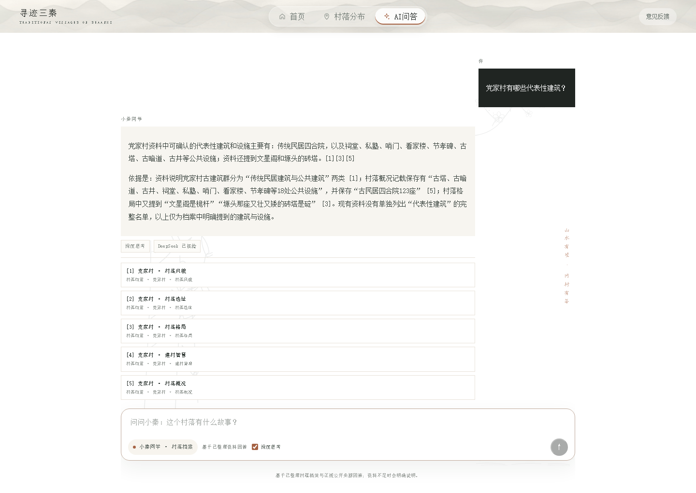
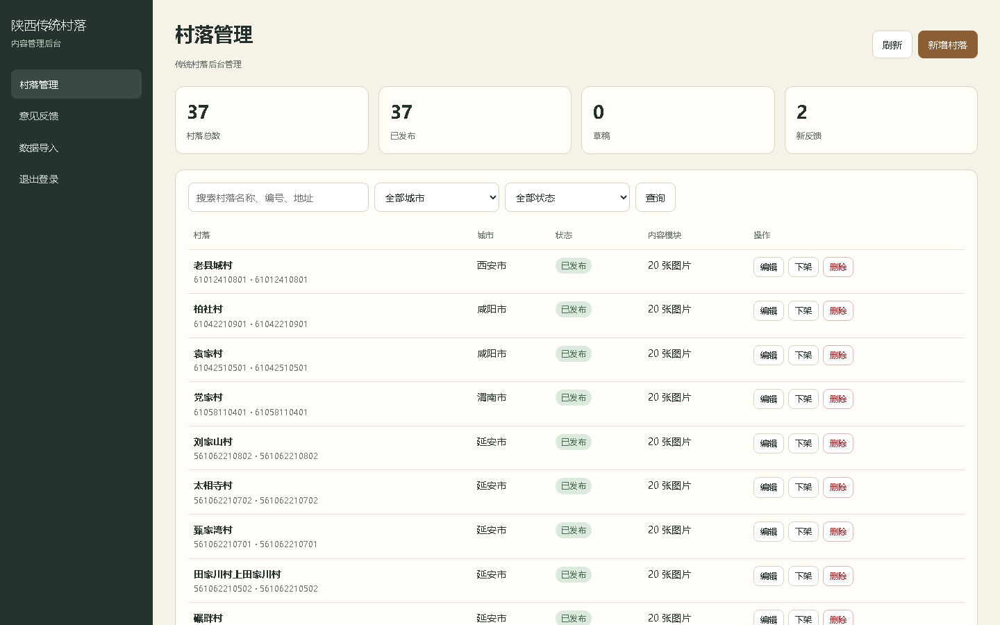
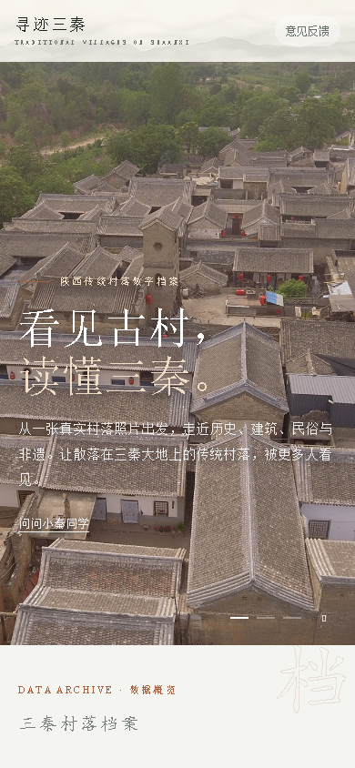

# 寻迹三秦

陕西传统村落数字档案与 AI 导游平台，面向 AI Web 网页开发挑战赛。

## 项目简介

“寻迹三秦”以陕西传统村落为核心，将村落分布、历史文化、传统建筑、环境格局、民俗非遗、美食物产、村志族谱和旅游导览整理为可浏览的数字档案，并通过“小秦同学”提供有资料依据的 AI 问答。

平台不是简单的聊天页面：AI 会先检索本地村落档案，再结合 DeepSeek 深度思考生成回答，并返回可核验的资料链接。本地资料不足时，只允许检索政府、官方媒体和传统村落官方网站；没有可靠来源时明确提示资料不足，不编造内容。

## 作品亮点

- 37 个陕西传统村落，939 个内容模块，内容按城市和村落动态组织
- 村落分布地图、城市列表、村落详情和村庄历史内容联动
- 小秦同学 AI 导游：本地档案检索、DeepSeek 深度思考、来源引用
- 正规网页来源白名单：政府、官方媒体、传统村落官网优先
- 普通交流与村落知识问答自动分流
- 后台管理：城市、村落、内容模块、图片、反馈管理
- 图片上传自动转 WebP，压缩、去 EXIF、限制大小
- 意见反馈支持邮箱校验、蜜罐、限流和重复提交检查
- 响应式布局，支持桌面、平板和手机访问

## 技术栈

### 前端

- 原生 HTML / CSS / JavaScript
- 响应式布局
- SVG 中国风线描装饰
- 页面轮换、村落图片轮换和动态内容渲染

### 后端

- Python 3.11
- FastAPI
- Uvicorn
- SQLAlchemy 2
- Pydantic v2
- SQLite（可通过环境变量切换 PostgreSQL）
- PBKDF2-SHA256 管理员密码哈希
- Bearer Token 管理会话
- DeepSeek API
- Pillow 图片处理

### AI 检索

- 本地村落档案检索
- DeepSeek `deepseek-reasoner` / `deepseek-chat`
- 正规网页来源检索与域名白名单过滤
- Tavily API 可选
- Bing RSS 兜底检索

## 目录结构

```text
backend/
  app/
    routers/        API 路由
    services/       数据导入、检索、AI、图片和邮件服务
    static/         前端页面、图片和样式
    main.py         FastAPI 入口
  tests/            冒烟测试
data/
  app.db            预置数据库
  processed/        已整理村落数据
  uploads/          后台上传图片目录
deployment/         Nginx 与 systemd 示例
docs/screenshots/   运行截图
DEPLOY.md           服务器部署说明
start.sh            Linux 启动脚本
start.ps1           Windows 启动脚本
```

## 本地运行

```bash
python -m venv .venv
source .venv/bin/activate
pip install -r backend/requirements.txt
python -m uvicorn backend.app.main:app --host 127.0.0.1 --port 8010
```

打开：

```text
http://127.0.0.1:8010/
```

后台地址：

```text
http://127.0.0.1:8010/admin
```

## 环境变量

复制模板：

```bash
cp backend/.env.example .env
```

填写 `DEEPSEEK_API_KEY`，但不要把真实密钥提交到 GitHub、Gitee 或公开附件。

AI 相关变量：

```text
DEEPSEEK_API_KEY=
DEEPSEEK_BASE_URL=https://api.deepseek.com
DEEPSEEK_CHAT_MODEL=deepseek-chat
DEEPSEEK_REASONER_MODEL=deepseek-reasoner
AI_WEB_SEARCH_ENABLED=1
TAVILY_API_KEY=
```

如果没有配置 DeepSeek 密钥，村落档案页面仍能正常使用，AI 会退回本地档案检索模式。

## 数据说明

压缩包内数据库已经预置：

- 37 个村落
- 10 个城市
- 939 个内容模块
- 2626 条媒体记录

不要重复运行 `backend/seed.py`，否则会覆盖对应村落的内容模块。只有在明确执行全量重新导入时才运行它。

## 运行截图

### 首页



### 村落分布



### 城市村落



### 村落详情



### AI 问答



### 后台管理



### 手机端



## 说明

真实 API 密钥不进入源码、前端、数据库或截图。部署时通过环境变量注入，提交到 GitHub/Gitee 的代码只保留 `.env.example` 中的空配置项。
